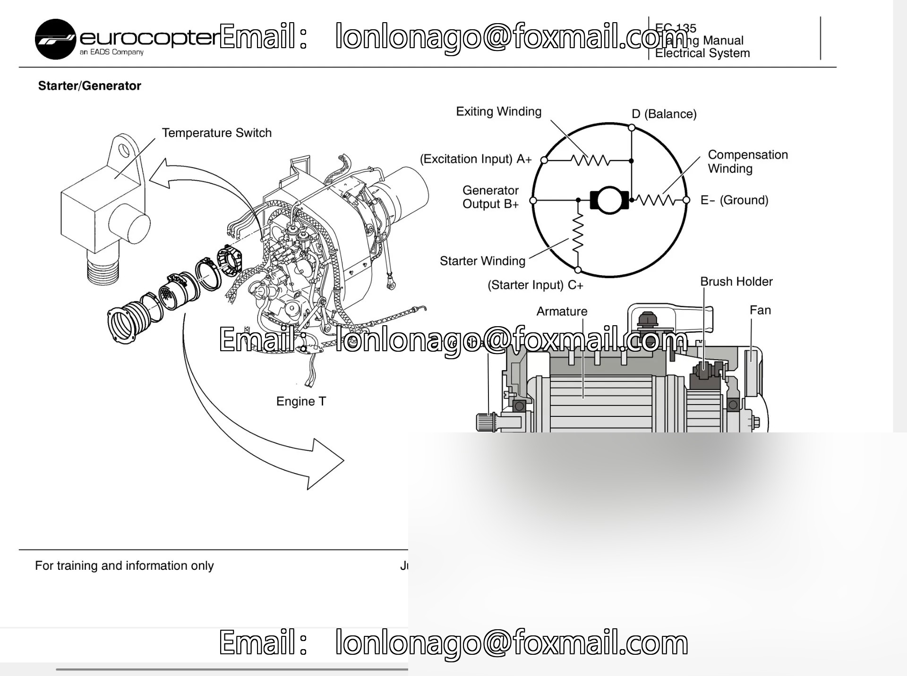
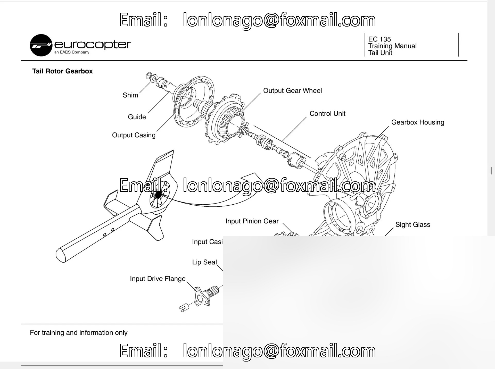
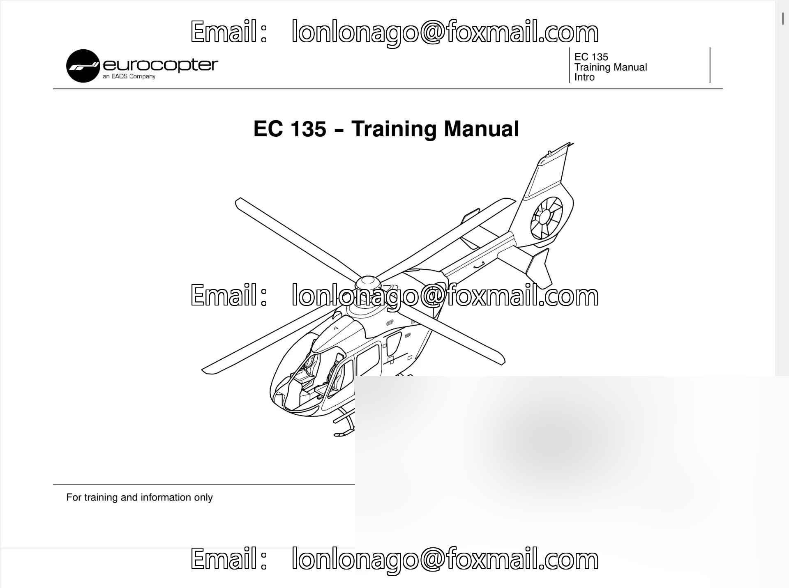

# European Helicopter German Co., Ltd. (EADS subsidiary) - EC 135 helicopter

## Body

European Helicopter Germany Limited (a subsidiary of EADS) - EC 135 helicopter training manual, 550-page PDF .

The content covers the EC 135 helicopter training manual from the European Helicopter Germany (EADS subsidiary), 550 pages in PDF format, including electrical systems, starter/generator, structural components and training purposes.

<!-- AI_ENRICHED -->

## Images

## Payment

Here is a pay link on Stripe ( https://buy.stripe.com/3cs8yP7sY87d0vu9AB ). Please contact me lonlonago@foxmail.com after funding $89, and I will send you a complete data files , thank you!

